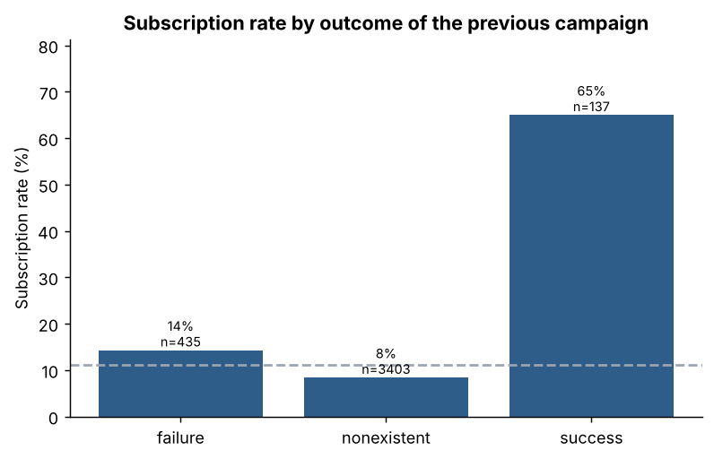
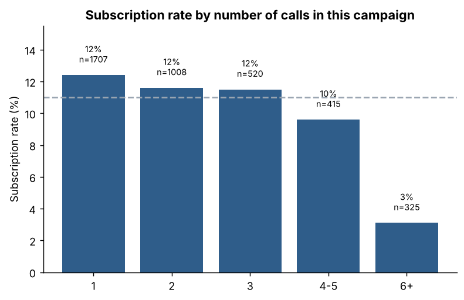
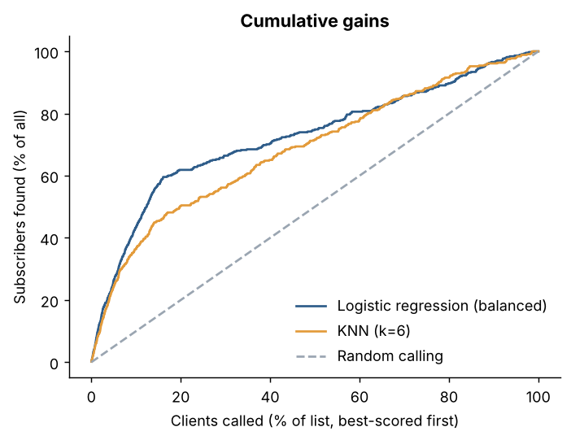

# Bank Marketing: who subscribes to a term deposit?

Analysis of a Portuguese bank's phone marketing campaigns. Only **11% of contacted clients subscribed**, so most calls were wasted.
The project finds which clients and campaign conditions go with a higher subscription rate, and builds a model that
ranks clients so the bank can call the most promising ones first.

**Main result:** calling only the **top 20% of clients** ranked by the model would reach **62% of all subscribers**,
with about **one call in three** successful instead of one in nine.

## Key findings

| Finding | Detail |
|---|---|
| Past success is the strongest signal | Clients who said yes in a previous campaign subscribed again in **65%** of cases (n=137). |
| Repeated calls bring diminishing returns | Subscription rate falls from **12%** after one call to **3%** after six or more. |
| Contact channel matters | Mobile (`cellular`) contacts: **14%**; landline: **5%**. |
| Client profile | Clients aged 60+ (**38%**), students and retired clients (**23%**) subscribe most; blue-collar workers and entrepreneurs least (**6-7%**). |
| Timing | May had the most calls but one of the lowest rates (**7%**). |

<p align="center">
  
  
</p>

## Model

Three models are compared with **5-fold stratified cross-validation**:

| Model | Accuracy | Precision (yes) | Recall (yes) | ROC AUC |
|---|---|---|---|---|
| Baseline (always "no") | 0.890 | 0.000 | 0.000 | 0.500 |
| KNN (k=6) | 0.890 | 0.500 | 0.299 | 0.700 |
| **Logistic regression (balanced)** | 0.824 | 0.338 | **0.619** | **0.753** |

- **Accuracy is misleading here**: a model that always says "no" is already 89% accurate and finds no subscriber.
  Recall (share of real subscribers found) and precision matter more.
- **KNN** is no more accurate than the baseline and finds only 30% of subscribers.
- **Logistic regression with balanced class weights** finds 62% of subscribers. It flags more clients who say no,
  but for a bank a missed subscriber usually costs more than an extra call.

<p align="center">
  
</p>

## Data cleaning decisions

- Missing values are coded as `"unknown"`. Rows with unknown `job`, `housing` or `loan` are dropped (3.5% of rows);
  unknown `marital` and `education` values are filled with the most frequent value.
- Unknown `default` answers (about 20%) are kept as their own category: not answering is itself information.
- `pdays = 999` means "never contacted before" and is replaced by a 0/1 flag.
- **`duration` is removed.** Call length is only known after the call ends, so using it would leak the answer into the model.

## Project structure

```
├── analysis.ipynb      # full analysis with outputs (start here)
├── app.py              # interactive Streamlit app
├── bank_analysis.py    # cleaning, analysis and modelling functions used by both
├── data/
│   └── bank-additional.csv
├── images/             # charts used in this README
└── requirements.txt
```

## How to run

```bash
pip install -r requirements.txt
jupyter notebook analysis.ipynb   # the analysis
streamlit run app.py              # the interactive app
```

The app lets you explore subscription rates by any client group, and move the model's decision threshold
to see the trade-off between recall and precision.

## Limitations

- The data is a 10% sample (4,119 clients), so rates for small groups and some months are uncertain.
- Calls span several years (2008-2010) and the economic indicators mostly describe *when* a client was called.
  Cross-validation mixes periods, so results on a future campaign could be lower.
- The 0.5 decision threshold is a default; in practice it should be set from the real cost of a call and the value of a deposit.

## Tools

Python, pandas, scikit-learn, matplotlib, Streamlit, Jupyter.

## Data source

[Bank Marketing dataset](https://archive.ics.uci.edu/dataset/222/bank+marketing), UCI Machine Learning Repository
(CC BY 4.0, DOI [10.24432/C5K306](https://doi.org/10.24432/C5K306)).
S. Moro, P. Cortez and P. Rita, *A Data-Driven Approach to Predict the Success of Bank Telemarketing*,
Decision Support Systems, 2014.

## Author

**Ali Bahar**, MSc in Data Science, University of Verona
